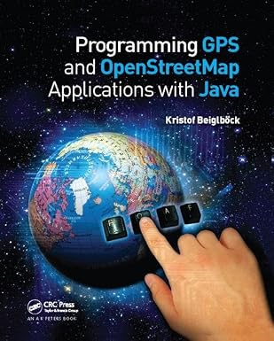

:toc: left

= repo content

This repository serves as development environment + 
for the  
https://www.amazon.com/Programming-GPS-OpenStreetMap-Applications-Java/dp/1138413747[The RealObject Application Framework] +
described in the book

// .Programming GPS and OpenStreetMap Applications with Java + The RealObject Application Framework

// align=center,

click image to get more details

== intro

Blue Marble Simulations `bm-sim` is a Java-based multi-module Maven project focused on GPS tracking simulations. 
It provides client-side tooling around Traccar, integrating it with Spring Boot and Apache Camel 
to simulate and process location data in real-time. 

include::project-desc.adoc[lines=4..11]

xref:project-desc.adoc[read on ...]

= by folder

== `/workflows` 

include::workflows.adoc[lines=5..6]

xref:workflows.adoc[read on ...]

== `/bm-parent`

include::bm-parent/bm-parent.adoc[lines=7..19]

xref:bm-parent/bm-parent.adoc[read on ...]

== `/bm-tracker`

include::bm-tracker/bm-tracker.adoc[lines=6..12]

xref:./bm-tracker/bm-tracker.adoc[Global Positioning in Space & Time ...]

=== `gps-osmand-tracker`

// content file
include::bm-tracker/gps-osmand-tracker/gps-tracker.adoc[lines=5..17]

// index file
xref:./bm-tracker/gps-osmand-tracker/gps-osmand-tracker.adoc[read on ...]

=== `gps-osmand-player`

include::bm-tracker/gps-osmand-player/gps-osmand-player.adoc[lines=14..24]

xref:./bm-tracker/gps-osmand-player/gps-osmand-player.adoc[read on ...]

=== `gpx-osmand-player`

include::bm-tracker/gpx-osmand-player/gpx-osmand-player.adoc[lines=9..22]

xref:./bm-tracker/gpx-osmand-player/gpx-osmand-player.adoc[read on ...]

== `/bm-traccar-` 

include::bm-traccar/bm-traccar.adoc[lines=7..17]

xref:./bm-traccar/bm-traccar.adoc[read more to setup and adopt your development environment]

=== `openapitools-client`

include::./bm-traccar/traccar-openapitools-client/openapitools.adoc[lines=6..23]

xref:./bm-traccar/traccar-openapitools-client/openapitools.adoc[details ...]

=== `api-client`

include::./bm-traccar/traccar-api-client/traccar-api-client.adoc[lines=9..14]

xref:./bm-traccar/traccar-api-client/traccar-api-client.adoc[details ...]

=== `realtime-client`

include::./bm-traccar/traccar-realtime-client/traccar-realtime-client.adoc[lines=7..14]

xref:./bm-traccar/traccar-realtime-client/traccar-realtime-client.adoc[details ...]

=== `realtime-service`

include::./bm-traccar/traccar-realtime-service/traccar-realtime-service.adoc[lines=7..16]

xref:./bm-traccar/traccar-realtime-service/traccar-realtime-service.adoc[details ...]

== `/bm-realtime-apps`

include::bm-realtime-apps/bm-realtime-apps.adoc[lines=7..12]

stay tuned ...

// xref:./bm-realtime-apps/bm-realtime-apps.adoc[read on ...]

=== `scotland-yard`

include::./bm-realtime-apps/scotland-yard/scotland-yard.adoc[lines=7..12]

xref:./bm-realtime-apps/scotland-yard/scotland-yard.adoc[details ...]

== `/bm-docs`

include::bm-docs/ascii-doctor.adoc[lines=7..9]

xref:bm-docs/ascii-doctor.adoc[read on ...]

