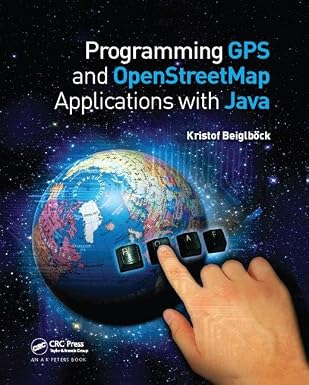

:toc: left

= repo content

This repository serves as development environment + 
for the  
https://www.amazon.com/Programming-GPS-OpenStreetMap-Applications-Java/dp/1138413747[The RealObject Application Framework] +
described in the book

// .Programming GPS and OpenStreetMap Applications with Java + The RealObject Application Framework

// align=center,

click image to get more details

== intro

Blue Marble Simulations `bm-sim` is a Java-based multi-module Maven project focused on GPS tracking simulations. 
It provides client-side tooling around Traccar, integrating it with Spring Boot and Apache Camel 
to simulate and process location data in real-time. 

== overview

The goal is to provide reusable Java clients and tools for 

* Generating a _strongly-typed Java client_ from Traccar's OpenAPI spec 
* Sending GPS position data to a Traccar/OsmAnd server (as a simulated tracker device)
* Receiving real-time updates from a Traccar server via REST API and WebSocket

      branch  /bm-tracker                   /bm-traccar
      . 
      [gps-osmand-tracker]                     [traccar-realtime-client]
        TrackerOsmAnd                              RealTimeClient 
            │ .send()                                      │ live updates 
            ▼                                              ▼
        Camel direct/seda route               RealTimeController.loginAndInitialize()
            │                                              │  [traccar-openapitools-client]
            ▼                                              ├─ REST API [traccar-api-client]
        HTTP POST to OsmAnd endpoint                       │    └─ /api/users
        (Traccar DCS:5055)                                 |       /api/devices
            │                                              |
            │                                              └─ WebSocket (vertx-websocket)
            ▼                                                   └─ /api/socket
        Traccar Server                                                │
        stores position                   ▲                           ▼
        and sends updates                 |                WebSocketRoute (Camel CBR)
        to [traccar-realtime-client] -----+                 │             <Entity> Processors
                                                            ├─ devices   →   DeviceProcessor
                                                            └─ positions → PositionProcessor
            ▲                                                       │              :    
            |                                                       ▼
            | creates, controls,                              RealTimeManager (state)
            | observes trackers                                     |
            |                                                       |
            +-------------- [traccar-realtime-service] -------------+
            |        combines Tracker, API and RealTimeClient       |
            |       to a full real-time Application (Boot app)      |
            +-------------------------------------------------------+

=== latest versions

include::releases.adoc[lines=2..12]

For earlier versions check the 
xref:releases.adoc[version history] 

=== Quickstarts

The page you are reading is a description 
of the project structure and the development process. 

include::./quickstarts/bm-quickstarts.adoc[lines=5..8]

If you are looking for a quickstart to get started with each project, 
xref:./quickstarts/bm-quickstarts.adoc[goto quickstarts ...]

// these headings reflect the projects file structure 
// but are not part of the big repo toc !

== `/workflows` 

include::workflows.adoc[lines=5..6]

xref:workflows.adoc[read on ...]

== `/bm-parent`

include::bm-parent/bm-parent.adoc[lines=7..19]

xref:bm-parent/bm-parent.adoc[read on ...]

== Integrated Development

The GPS Tracker and Player were developed as client senders for the Traccar GTS.
Each project test is running standalone for each Unit.
For a _full integrated development cycle_ we run the Traccar Server in a Docker container 
and look into the server state with the Traccar REST API and websocket interface.
This development is done in the `bm-traccar` branch.
The `traccar-realtime-client` is an important milestone as it allows 
a _full roundtrip engineering_ in an integrated development cycle.

Therefor the longterm Tracker and Player development happen in the `traccar-realtime-client` project.

xref:./bm-traccar/traccar-realtime-client/integrated-dev-cycle.adoc#_integrated_tracker_development[read about the Integrated Development Cycle]

== `/bm-tracker`

include::bm-tracker/bm-tracker.adoc[lines=6..12]

xref:./bm-tracker/bm-tracker.adoc[Global Positioning in Space & Time ...]

=== `gps-osmand-tracker`

// content file
include::bm-tracker/gps-osmand-tracker/gps-tracker.adoc[lines=5..17]

// index file
xref:./bm-tracker/gps-osmand-tracker/gps-osmand-tracker.adoc[read on ...]

=== `gps-osmand-player`

include::bm-tracker/gps-osmand-player/gps-osmand-player.adoc[lines=14..24]

xref:./bm-tracker/gps-osmand-player/gps-osmand-player.adoc[read on ...]

=== `gpx-osmand-player`

include::bm-tracker/gpx-osmand-player/gpx-osmand-player.adoc[lines=9..22]

xref:./bm-tracker/gpx-osmand-player/gpx-osmand-player.adoc[read on ...]

== `/bm-traccar` 

include::bm-traccar/bm-traccar.adoc[lines=7..17]

xref:./bm-traccar/bm-traccar.adoc[read more to setup and adopt your development environment]

=== `-openapitools-client`

include::./bm-traccar/traccar-openapitools-client/openapitools.adoc[lines=6..23]

xref:./bm-traccar/traccar-openapitools-client/openapitools.adoc[details ...]

=== `-api-client`

include::./bm-traccar/traccar-api-client/traccar-api-client.adoc[lines=9..14]

xref:./bm-traccar/traccar-api-client/traccar-api-client.adoc[details ...]

=== `-realtime-client`

include::./bm-traccar/traccar-realtime-client/traccar-realtime-client.adoc[lines=7..14]

xref:./bm-traccar/traccar-realtime-client/traccar-realtime-client.adoc[details ...]

=== `-realtime-service`

include::./bm-traccar/traccar-realtime-service/traccar-realtime-service.adoc[lines=7..16]

xref:./bm-traccar/traccar-realtime-service/traccar-realtime-service.adoc[details ...]

== `/bm-docs`

include::bm-docs/ascii-doctor.adoc[lines=5..10]

xref:bm-docs/ascii-doctor.adoc[read on ...]

== gps2gts2realtime *Milestone*

The `v1.1.x` prototyping of the two branches `/bm-tracker` and `/bm-traccar` is concluded with the `traccar-realtime-client`.
As a proof of concept we have implemented the full flow of data from the trackers to the server to the Real Time Client,
including the setup of a scenario on the server.

These ground layers of the ROAF are now in place and we can start building on top of them. +
Or they can be used as a solid basis for your own projects. 

Make sure to execute the 
xref:./bm-traccar/traccar-realtime-client/traccar-realtime-client-qs.adoc[Quickstart]
of the `traccar-realtime-client` to setup your development environment.

Then you can go into details and use a blueprint
xref:./bm-traccar/milestone/bm-traccar-milestone.adoc[here]
for your own step by step development of GPS tracking applications.

=== roundtrip engineering

Also Note that with the cycle Tracker2GTS2RealTime we start with roundtrip engineering 
on any of the involved Components with integrated Traccar Server. 

For example we can use the Traccar Server Events as a certified (i.e. Third Party) Tracker Event. 
Therfore you will find integration tests for 
xref:./bm-traccar/traccar-realtime-client/integrated-dev-cycle.adoc[Tracker development]
in the `traccar-realtime-client` project
using the Tracker's package names `bm.gps.tracker`. This is a common development cycle and 
the developer should be aware that the projects, like the Tracker and RealTimeClient
have to be compiled sequentially, before testing a new Tracker feature in the RealTimeClient project.

